> **TL;DR**
>
> - Both kinds of model learn a probability distribution. The difference is *which* one: a discriminative model learns $P(\text{y}\mid\text{x})$ (labels given inputs), and a generative model learns a distribution that includes the inputs themselves, $P(\text{x},\text{y})$ or $P(\text{x})$.
> - "Learning a distribution" means maximum likelihood, which approximately minimizes the KL divergence to the true data distribution. The recipe is the same for both kinds of model. Only the quantity inside the likelihood changes.
> - Naive Bayes and logistic regression end up with a classifier of the *same form*. Naive Bayes gets there by modeling what emails look like, so it can also generate them. Logistic regression models only the labels.
> - An LLM is a generative model. Each next-token step is a classifier, but the product of those steps is a distribution over whole texts.

---

## Introduction

The most common answer to "What is the difference between discriminative and generative models?" is: *discriminative models learn the boundary, generative models learn the data distribution.*

It is correct, and it is also one of those answers we can recite without really understanding it. It also raises several questions:

1. What does "learning the distribution" actually mean in terms of what is being optimized?
2. Why is logistic regression discriminative but Naive Bayes generative, when both produce $P(y\mid x)$ [the probability of label $y$ given input $x$] for classification?
3. How can generative models produce new inputs while discriminative models cannot?
4. An LLM (built on the Transformer architecture ([Vaswani et al., 2017](https://arxiv.org/abs/1706.03762))) is trained to predict the next token given all previous tokens, which looks like supervised classification at each step. So how is it generative?

We will answer all of these in a supervised binary classification setting (chosen for simplicity), using email spam detection as a running example. Then we will extend the same ideas to see why large language models are generative.

Along the way we will also build up a general picture of **parameterization**: how we turn a probability distribution into a function of learnable parameters.

This post assumes basic probability (joint, conditional, Bayes' rule) and some familiarity with ML (training, loss functions). Anything beyond that is recapped in the [appendix](#appendix).

---

## Notation

> **How to read the math.** Upright letters such as $\text{x}$ denote a *random variable* (or, inside $P(\text{y}\mid\text{x})$, the *whole distribution*). Italic letters such as $x$ denote a specific *value* (an instance). So $P(\text{y}\mid\text{x})$ is the conditional distribution as an object, and $P(y\mid x)$ is the single number it assigns to a particular label $y$ and input $x$. If the difference is hard to see on screen, don't worry: the context always makes it clear.
>
> A bar means "given" (conditioning). A semicolon introduces parameters: $P(y\mid x;\theta)$ reads "the probability of $y$ given $x$, under parameters $\theta$". In sums and $\operatorname{argmax}$, a letter such as $c$ is a dummy variable that ranges over all its possible values.

Every symbol is also defined where it is first used, so you can skip the full table below and come back to it when needed.

<details>
<summary><strong>Full symbol table</strong> (click to expand)</summary>

| Symbol | Meaning |
|---|---|
| **Data** | |
| $\mathcal{X}$, $\mathcal{Y}=\{0,1\}$ | Input space and label space ($1$ = spam, $0$ = ham) |
| $\text{x}$, $\text{y}$ | Random variables for an input and a label |
| $x$, $y$ | Specific values (instances) of $\text{x}$ and $\text{y}$ |
| $x_i$, $y_i$ | Input and label of the $i$-th training example |
| $D$, $n$ | Training set $\{(x_i,y_i)\}_{i=1}^n$ (a set of examples, not a distribution) and its size |
| **Distributions** | |
| $P^\ast$ | The true, unknown data-generating distribution |
| $P(\cdot\,;\theta)$ | Our model, with parameters $\theta$ |
| $\sim$, $\overset{\text{i.i.d.}}{\sim}$ | "is drawn from"; "drawn independently from the same distribution" |
| $\mathbb{E}$ | Expectation (average over a distribution) |
| $\mathrm{KL}(P\,\Vert\,Q)$ | Kullback–Leibler divergence, a measure of how far $Q$ is from $P$ ([Appendix E](#appendix-e-entropy-cross-entropy-and-kl-divergence)) |
| **Learning** | |
| $\theta$ | Model parameters |
| $\theta^\star$, $\hat\theta$ | Ideal parameters (minimize KL to $P^\ast$); parameters found by maximum likelihood on $D$ |
| $L(\theta)$, $\ell(\theta)$ | Likelihood and log-likelihood, $\ell(\theta)=\log L(\theta)$ |
| $\operatorname{argmax}$ | The value of the argument (here, $\theta$) that maximizes a function |
| $\hat y$ | Predicted label |
| **Logistic regression** | |
| $f_\theta(x)$ | The model's output, $P(y{=}1\mid x;\theta)$ |
| $w$, $b$, $\sigma$ | Weight vector, bias, sigmoid function |
| $p_i$ | Shorthand for $f_\theta(x_i)$ |
| **Text and Naive Bayes** | |
| $V$, $\lvert V\rvert$ | Vocabulary (the set of tracked words) and its size |
| $k$ | Word index, $k\in\{1,\dots,\lvert V\rvert\}$ |
| $m_i$, $j$ | Number of words in email $i$; position index within an email |
| $x_{i,j}$ | The word at position $j$ of email $i$, as an index into $V$ |
| $t(x)$, $t_i$, $t_{i,k}$ | Bag-of-words count vector of email $x$; of email $i$; count of word $k$ in email $i$ |
| $t_k$ | Count of word $k$ in a single generic email |
| $c$ | A class value in $\mathcal{Y}$ |
| $\pi$ | Class prior, $P(y{=}1)$ |
| $\phi_{k\mid c}$ | $P(\text{word }k\mid y{=}c)$ |
| $N_c$, $N_{k,c}$, $M_c$ | Number of class-$c$ emails; total count of word $k$ in class-$c$ emails; total words in class-$c$ emails |
| $\mathbb{1}\{\cdot\}$ | Indicator: $1$ if the condition holds, else $0$ |
| $\mathcal{J}$, $\lambda_c$ | Lagrangian and Lagrange multiplier ([Appendix F](#appendix-f-lagrange-multipliers-and-concavity)) |
| **Language models** | |
| $x_{\lt j}$ | The prefix $(x_1,\dots,x_{j-1})$ |
| $h_j$, $g_\theta$ | Learned representation of the prefix; the function that computes it |
| $s$, $r$ | A prompt $(s_1,\dots,s_a)$ and a response $(r_1,\dots,r_b)$ |
| $N_{\text{tok}}$ | Total number of token positions in the training corpus |
| $n$ in "n-gram" | The context length of an n-gram model (unrelated to the dataset size $n$) |

</details>

---

## Supervised learning setup for classification

We will be doing binary classification, and we assume we are given a training set $D$:

$$D=\{(x_1,y_1),\ (x_2,y_2),\ \ldots,\ (x_n,y_n)\}$$

- $n$ is the number of examples.
- $x_i\in\mathcal{X}$ is the input of the $i$-th example. $\mathcal{X}$ is the **input space** (every possible input). We keep it abstract for now. It could be $\mathbb{R}^d$ for numeric features, or sequences of words for text.
- $y_i\in\mathcal{Y}=\{0,1\}$ is the label of the $i$-th example. $\mathcal{Y}$ is the **label space** (every possible answer).

Where does this data come from? Think of emails arriving in an inbox. Which emails show up is random, and whether a given email counts as spam is not a deterministic function of its text (two people may label the same email differently). We capture this by treating an input and its label as random variables $\text{x}$ and $\text{y}$, drawn from an unknown **true data-generating distribution** $P^\ast(\text{x},\text{y})$. You can think of $P^\ast$ as the real-world process that produces emails: for spam, it reflects what scammers know and want; for ham, what colleagues and friends need to say. The training set is an i.i.d. sample from it ([Appendix B](#appendix-b-iid-sampling)):

$$(x_i,y_i)\ \overset{\text{i.i.d.}}{\sim}\ P^\ast(\text{x},\text{y}),\qquad i=1,\dots,n$$

Note the difference: $D$ is a finite *sample*, and $P^\ast$ is the unknown *source* it came from. Machine learning is, in the end, an attempt to learn something about $P^\ast$ from $D$.



*Figure A: The training set $D$ is a small, finite window into the unknown distribution $P^\ast$; each example is an independent draw.*
{.caption}

For classification, the thing we want is the conditional distribution $P^\ast(\text{y}\mid\text{x})$: given an input, how likely is each label? We cannot write it down, so we choose a family of candidate distributions $P(\text{y}\mid\text{x};\theta)$ indexed by parameters $\theta$, and look for the best $\theta$.

> **Definition: parameterizing a distribution.** Choosing a formula for a probability mass function (discrete) or density (continuous) that contains adjustable numbers $\theta$. Each setting of $\theta$ gives one distribution. Training then picks the $\theta$ that best fits the data; in ML these $\theta$ are the model's weights.

---

## The one question: which distribution is the model learning?

Suppose, hypothetically, we knew $P^\ast(\text{x},\text{y})$. Then we could answer any probabilistic question about the data. The product rule ([Appendix A](#appendix-a-probability-recap)) lets us factor the joint in two ways. For every input $x$ and label $y$:

$$P^\ast(x,y)=P^\ast(x\mid y)\,P^\ast(y)\tag{1}$$

$$P^\ast(x,y)=P^\ast(y\mid x)\,P^\ast(x)\tag{2}$$

Rearranging (2) gives the conditional we need for classification, $P^\ast(y\mid x)=P^\ast(x,y)/P^\ast(x)$. Equating (1) and (2) gives Bayes' rule:

$$P^\ast(y\mid x)=\frac{P^\ast(x\mid y)\,P^\ast(y)}{P^\ast(x)},\qquad P^\ast(x)=\sum_{c\in\mathcal{Y}}P^\ast(x\mid c)\,P^\ast(c)\tag{3}$$

(For continuous $x$, replace the sum with an integral.)

So the joint contains the conditional, and more. That raises a natural question: instead of estimating only $P^\ast(\text{y}\mid\text{x})$, can we estimate the joint from the data? Supervised learning approaches split by how they answer ([Rubinstein & Hastie, 1997](https://cdn.aaai.org/KDD/1997/KDD97-008.pdf); [Ng & Jordan, 2002](https://papers.nips.cc/paper_files/paper/2001/hash/7b7a53e239400a13bd6be6c91c4f6c4e-Abstract.html)):

> **Definition**
>
> - **Discriminative learning** models only the conditional $P(\text{y}\mid\text{x};\theta)$. Inputs are taken as given and never modeled.
> - **Generative learning** models the joint, typically through (1): a class prior $P(\text{y};\theta)$ times a class-conditional distribution $P(\text{x}\mid\text{y};\theta)$. What matters is that the model includes a distribution over the inputs.


*Figure B: A discriminative model learns only $P(y\mid x)$, which is pinned down by where the classes separate. A generative model learns how each class is spread out, and the boundary is derived from those densities. (Illustrated with two continuous features for visibility.)*
{.caption}

Both approaches learn a distribution, and which *distribution* it models determines what the model can do.

**A discriminative model** outputs a distribution over labels given an input. We can predict, or sample, a label for an input we already have. Nothing in the model describes what inputs look like, so it cannot produce new ones.

**A generative model** assigns a probability to every input–label pair. That gives us four abilities:

1. **Classify**, through Bayes' rule (3). The denominator $P(x)$ is the same for every class, so to classify we only need to compare $P(x\mid y)\,P(y)$ across classes.
2. **Sample** new inputs: draw a label from the prior, then draw an input from that class's distribution.
3. **Score** inputs: the denominator of (3) says how likely an input is under the model. (A caveat: high likelihood does not always mean "looks like the training data". Deep generative models can assign *higher* likelihood to out-of-distribution inputs than to their own training data ([Nalisnick et al., 2019](https://arxiv.org/abs/1810.09136)).)
4. **Handle missing data**: if part of an input is missing, sum (or integrate) the joint over the missing part, $P(x_{\text{observed}})=\sum_{x_{\text{missing}}}P(x_{\text{observed}},x_{\text{missing}})$. A model of $P(y\mid x)$ alone offers no principled way to do this; the missing values have to be filled in by some method outside the model.

> **Intuition: boundary vs distribution.** Both kinds of classifier end up with a decision boundary, the set of inputs where the two classes are equally probable. A discriminative model reaches it through $P(y{=}1\mid x;\theta)=0.5$. A generative model reaches it where $P(x\mid y{=}1)\,P(y{=}1)=P(x\mid y{=}0)\,P(y{=}0)$. The difference is not whether a boundary exists, but what the model had to learn to get one.

Why not always go generative, since it gives more? Because it also demands more. A discriminative model spends all of its capacity on $P(\text{y}\mid\text{x})$. A generative model must also model the inputs, which is usually the harder part (we will see exactly how hard shortly). This tradeoff has been studied for decades ([Efron, 1975](https://doi.org/10.1080/01621459.1975.10480319); [Ng & Jordan, 2002](https://papers.nips.cc/paper_files/paper/2001/hash/7b7a53e239400a13bd6be6c91c4f6c4e-Abstract.html)). The usual picture: with plenty of labeled data, discriminative classifiers typically reach lower error; with little data, the structure a generative model assumes can act as a helpful bias and let it win. So "discriminative is better when you only care about the label" is a tendency, not a rule. We will make this more precise once we have both models in hand.

> **Aside: scope of this post.** We focus on probabilistic models trained by maximum likelihood. Two caveats. First, not every discriminative model is probabilistic: a support vector machine ([Cortes & Vapnik, 1995](https://doi.org/10.1007/BF00994018)) learns a boundary directly, with no $P(y\mid x)$. Second, not every generative model is trained by plain maximum likelihood. GANs ([Goodfellow et al., 2014](https://arxiv.org/abs/1406.2661)) learn to sample without ever writing down $P(x)$, while VAEs ([Kingma & Welling, 2014](https://arxiv.org/abs/1312.6114)) and diffusion models ([Ho et al., 2020](https://arxiv.org/abs/2006.11239)) optimize a bound on the likelihood rather than the likelihood itself. The "which distribution?" question is cleanest in the likelihood setting, so that is where we stay.

> **Key takeaway.** Ask one question: *which probability distribution is the model learning?* Decision boundaries, sampling, and the ability to generate new inputs all follow from the answer.

---

## What are we optimizing? KL divergence and maximum likelihood

Once we have a family $P(\text{y}\mid\text{x};\theta)$, how do we pick $\theta$? We want the model to be as close as possible to the truth. The **KL divergence** ([Kullback & Leibler, 1951](https://doi.org/10.1214/aoms/1177729694)) measures how far one distribution is from another ([Appendix E](#appendix-e-entropy-cross-entropy-and-kl-divergence)). It is always $\geq 0$, and it is $0$ exactly when the two distributions are identical. For a conditional model we average it over inputs:

$$\theta^\star=\underset{\theta}{\operatorname{argmin}}\ \ \mathbb{E}_{x\sim P^\ast(\text{x})}\Big[\mathrm{KL}\big(P^\ast(\text{y}\mid x)\ \Vert\ P(\text{y}\mid x;\theta)\big)\Big]\tag{4}$$

This is the ideal objective: we want the model's conditional distribution to be as close as possible to the true one. We cannot compute (4), because it needs $P^\ast$, which is always unknown. But look at what it contains. Expanding the KL divergence splits it into two terms:

$$\mathbb{E}_{x}\Big[\mathrm{KL}\big(P^\ast(\text{y}\mid x)\ \Vert\ P(\text{y}\mid x;\theta)\big)\Big]=\underbrace{\mathbb{E}_{(x,y)\sim P^\ast}\big[\log P^\ast(y\mid x)\big]}_{\text{does not depend on }\theta}\ -\ \mathbb{E}_{(x,y)\sim P^\ast}\big[\log P(y\mid x;\theta)\big]$$

The first term is a constant as far as $\theta$ is concerned. So minimizing the KL divergence is the same as maximizing the expected log-probability the model assigns to the true data. We cannot take that expectation under $P^\ast$, but we do have i.i.d. samples from $P^\ast$, and an average over samples approximates an expectation (the law of large numbers):

$$\theta^\star=\underset{\theta}{\operatorname{argmax}}\ \mathbb{E}_{(x,y)\sim P^\ast}\big[\log P(y\mid x;\theta)\big]\ \approx\ \underbrace{\underset{\theta}{\operatorname{argmax}}\ \frac{1}{n}\sum_{i=1}^{n}\log P(y_i\mid x_i;\theta)}_{\hat\theta\ :\ \text{the maximum likelihood estimate}}\tag{5}$$

The right-hand side only involves our training data, so we can compute it. This is **maximum likelihood estimation (MLE)** ([Fisher, 1922](https://doi.org/10.1098/rsta.1922.0009); [Appendix D](#appendix-d-likelihood-log-likelihood-and-mle)).

> **Note.** The approximation in (5) rests on two things. First, the samples must really be i.i.d. draws from $P^\ast$. If they are biased (say, emails from only one company), we approximate the wrong expectation. Second, $n$ must be large enough. With too few samples the average is noisy, and the model can overfit to the particular examples it saw. Separately, even with unlimited data, if no setting of $\theta$ can represent $P^\ast$ exactly, the smallest achievable KL is above zero, and MLE finds the closest member of the family ([White, 1982](https://doi.org/10.2307/1912526)).

> **Key takeaway.** "Learning a distribution" means choosing $\theta$ so the model assigns high probability to the data we observed. That is maximum likelihood, and it approximately minimizes the KL divergence to the true distribution. The recipe is the same whichever distribution we model (for the joint, replace $P(y\mid x;\theta)$ with $P(x,y;\theta)$). Only the quantity being maximized changes:
>
> - Discriminative: $\prod_{i=1}^{n} P(y_i\mid x_i;\theta)$
> - Generative: $\prod_{i=1}^{n} P(x_i,y_i;\theta)$

---

## Running example: representing an email

Let us classify emails as spam ($y=1$) or ham ($y=0$) to see how both modeling approaches work. For a fair comparison, both approaches should see exactly the same information, so we use the **bag-of-words** representation for both:

- A **vocabulary** $V$ of $\lvert V\rvert$ distinct words we track, indexed $1,\dots,\lvert V\rvert$.
- As a **sequence**, email $i$ is $x_i=(x_{i,1},x_{i,2},\dots,x_{i,m_i})$, where $m_i$ is the number of words and each $x_{i,j}\in\{1,\dots,\lvert V\rvert\}$ is the index of the word at position $j$.
- As a **count vector**, email $i$ is $t_i=(t_{i,1},\dots,t_{i,\lvert V\rvert})$, where $t_{i,k}$ is how many times word $k$ appears in the email, so $\sum_k t_{i,k}=m_i$. Counts forget word order. We also write $t(x)$ for the count vector of an email $x$.

> **Example.** Take a toy vocabulary $V=(\text{free},\ \text{prize},\ \text{click},\ \text{meeting},\ \text{report},\ \text{thanks})$, indexed $1,\dots,6$. The email "free prize free" is the sequence $x=(1,2,1)$ with $m=3$, and its count vector is $t(x)=(2,1,0,0,0,0)$.

The discriminative model will take the count vector $t(x)$ as its input, because logistic regression needs a fixed-length numeric vector. The generative model will model the word sequence directly, and we will see that its likelihood depends on an email only through its counts. So both approaches use the same information: which words appear, and how often.

With the running example in place, let us build both a discriminative and a generative classifier for spam, and see concretely how they differ.

---

## Discriminative approach: logistic regression

In the discriminative approach we model only $P(\text{y}\mid\text{x})$. How should we represent it? The most direct way would be a table with one spam probability per possible email. But with a vocabulary of $50{,}000$ words there are $50{,}000^{200}\approx 10^{940}$ possible 200-word emails, and a table could say nothing about emails it has never seen. Instead, we use a function with a small set of *shared* parameters that maps any email's word counts to a label probability.

**The model.** Logistic regression ([Cox, 1958](https://doi.org/10.1111/j.2517-6161.1958.tb00292.x)) computes a score from the word counts of an email $x$, $w^\top t(x)+b$. There is one weight per vocabulary word ($w\in\mathbb{R}^{\lvert V\rvert}$); after training, spammy words have positive weights and hammy words negative ones. The sigmoid $\sigma(z)=1/(1+e^{-z})$ then squashes the score into a probability:

$$f_\theta(x)=\sigma\big(w^\top t(x)+b\big)=P(y{=}1\mid x;\theta),\qquad \theta=(w,b)\tag{6}$$

Note that the output is a *probability*, not a label. $f_\theta(x)$ is the probability that email $x$ is spam, and $1-f_\theta(x)$ is the probability that it is ham. For example, with the illustrative weights in Figure D, the email "free prize free" gets the score $z=2(1.4)+1(0.6)-0.2=3.2$, and $\sigma(3.2)\approx 0.96$: a 96% probability of spam.



*Figure D: Logistic regression pipeline: email → bag-of-words → linear score → sigmoid → a distribution over labels only.*
{.caption}

**The distribution.** For each training email, the label follows a Bernoulli distribution ([Appendix C](#appendix-c-bernoulli-categorical-and-multinomial-distributions)) whose parameter is $p_i=f_\theta(x_i)$:[^bernoulli]

$$P(y_i\mid x_i;\theta)=p_i^{\,y_i}\,(1-p_i)^{1-y_i}$$

(If $y_i=1$ this equals $p_i$, and if $y_i=0$ it equals $1-p_i$.)

**The likelihood.** Since the examples are i.i.d., the probability of all the observed labels is the product of the per-example probabilities:

$$L(\theta)=\prod_{i=1}^{n}P(y_i\mid x_i;\theta)=\prod_{i=1}^{n}f_\theta(x_i)^{y_i}\,\big(1-f_\theta(x_i)\big)^{1-y_i}\tag{7}$$

$L(\theta)$ is the probability the model assigns to the labels we actually observed, viewed as a function of $\theta$ ([Appendix D](#appendix-d-likelihood-log-likelihood-and-mle)). Maximum likelihood picks the $\theta$ for which those labels are most probable.

Products of many numbers below $1$ underflow numerically and are awkward to differentiate, so we take the log. The log is increasing, so it does not change which $\theta$ maximizes the function:

$$\ell(\theta)=\log L(\theta)=\sum_{i=1}^{n}\Big[\,y_i\log f_\theta(x_i)+(1-y_i)\log\big(1-f_\theta(x_i)\big)\Big],\qquad \hat\theta=\underset{\theta}{\operatorname{argmax}}\ \ell(\theta)\tag{8}$$

If you look closely at $\ell(\theta)$, it is the negative of the **binary cross-entropy loss** that we usually minimize when training classifiers ([Appendix E](#appendix-e-entropy-cross-entropy-and-kl-divergence)). So maximizing the log-likelihood is the same as minimizing cross-entropy. There is no closed-form solution, so $\theta$ is found iteratively with gradient-based optimization. Fortunately, $\ell(\theta)$ is concave in $\theta$, so gradient ascent cannot get stuck in a bad local optimum.

**What can this model do?** It gives us the probability of spam for any email, and we can sample a label $y\sim\text{Bernoulli}(f_\theta(x))$ for an email we already have. But nothing in the model describes what emails look like. There is no distribution over emails to sample from. Since only the conditional distribution is modeled, this is a **discriminative** model.

> **Key takeaway.** Logistic regression chooses a function family for $P(y\mid x)$, fits it by maximum likelihood (equivalently, by minimizing cross-entropy), and ends up with a distribution over labels only. It says nothing about which emails exist.

---

## Generative approach: Naive Bayes

In the generative approach we model the joint distribution through equation (1):

$$P(x,y;\theta)=P(x\mid y;\theta)\,P(y;\theta)\tag{9}$$

So there are two pieces to parameterize: the **class prior** $P(\text{y};\theta)$ (how often is an email spam?) and the **class-conditional distribution** $P(\text{x}\mid\text{y};\theta)$ (what does a spam email look like, and what does a ham email look like?).

> **Intuition: what does the joint objective add?** Here is a precise way to see what modeling the joint buys, and what it costs. Maximizing the joint likelihood minimizes the *joint* KL divergence, which splits into two parts (the chain rule for KL; see [Cover & Thomas, 2006](https://doi.org/10.1002/047174882X), ch. 2):
>
> $$\mathrm{KL}\big(P^\ast(\text{x},\text{y})\,\Vert\,P(\text{x},\text{y};\theta)\big)=\mathrm{KL}\big(P^\ast(\text{x})\,\Vert\,P(\text{x};\theta)\big)+\mathbb{E}_{x\sim P^\ast(\text{x})}\Big[\mathrm{KL}\big(P^\ast(\text{y}\mid x)\,\Vert\,P(\text{y}\mid x;\theta)\big)\Big]$$
>
> Here $P(\text{x};\theta)$ and $P(\text{y}\mid x;\theta)$ are the marginal and conditional implied by the joint model. The second term is exactly the discriminative objective (4). The first term is extra: a generative model is also rewarded for modeling the inputs. With a perfectly flexible model both terms can reach zero together. With an imperfect model, such as Naive Bayes below, capacity spent on $P(\text{x})$ can cost accuracy on $P(\text{y}\mid\text{x})$. This is the precise version of "discriminative models don't spend capacity on inputs".

For spam classification, the simplest generative solution is **Naive Bayes**, one of the earliest successful spam filters ([Sahami et al., 1998](https://cdn.aaai.org/Workshops/1998/WS-98-05/WS98-05-009.pdf); [Graham, 2002](http://www.paulgraham.com/spam.html)). Below we build it step by step: why $P(\text{x}\mid\text{y})$ is hard to model, the assumptions that tame it, the MLE derivation, and what the learned model can do, including sampling new emails, which makes it generative. Classification then goes through Bayes' rule (3).

### The problem: a lookup table over emails

To use (1) we need $P(\text{x}\mid\text{y})$: the probability of an entire email given its class. The most direct way to represent a distribution is to store one probability per possible outcome. That works for a coin: one number $\theta=P(\text{heads})$, whose MLE is the fraction of heads. It works for a die: five free numbers (the sixth is fixed by the sum-to-one constraint). It breaks down for emails. An email of $m$ words drawn from a vocabulary of $\lvert V\rvert$ words is one of $\lvert V\rvert^m$ possible sequences. With $\lvert V\rvert = 50{,}000$ and $m = 200$, that is roughly $10^{940}$ outcomes, per class. A lookup table fails for three reasons:

1. **Size.** We cannot store, index, or estimate that many numbers.
2. **No generalization.** MLE on a lookup table reduces to relative frequency: $\hat P(x) = (\text{count of } x)/n$. Every email not in the training set gets probability zero. The model memorizes rather than learns.
3. **Variable structure.** Emails have different lengths, so we would need a separate table for each length.

Logistic regression faced a version of this problem too, but a much milder one: for each email it needs a distribution over just 2 labels, and a shared-parameter function handles that easily. A generative model must put a distribution over the emails themselves, a space of size $\lvert V\rvert^m$, and there is no way around that. Naive Bayes tames it with simplifying assumptions.

### The simplification: Naive Bayes assumptions

**1. Conditional independence (the "naive" assumption).** Given the class, the words of an email are independent of each other:

$$P(x\mid y)=\prod_{j=1}^{m}P(x_j\mid y)\tag{10}$$

The $10^{940}$-outcome distribution collapses into $m$ small distributions, one over words at each position.

**2. Position independence.** Every position uses the *same* word distribution for a given class:

$$P(x_j=k\mid y=c)=\phi_{k\mid c}\qquad\text{for every position }j\tag{11}$$

The model does not care *where* a word appears, only *which* words appear and how often. An email becomes a **bag of words**.

> **Example.** The probability of seeing "free" in a spam email is $\phi_{\text{free}\mid\text{spam}}$ whether it is the 1st word or the 50th. Reordering an email does not change its probability, because the same factors are simply multiplied in a different order:
>
> $$P(\text{"free prize now"}\mid\text{spam})=\phi_{\text{free}\mid\text{spam}}\,\phi_{\text{prize}\mid\text{spam}}\,\phi_{\text{now}\mid\text{spam}}=P(\text{"now free prize"}\mid\text{spam})$$
>
> This assumption is separate from conditional independence, and it is needed for two practical reasons. First, emails have different lengths, so "position 3" does not mean the same thing in a 10-word email and a 200-word one, and positions beyond the longest training email would have no data at all. Second, it lets every word occurrence in the training set, at any position, inform the same $\phi_{k\mid c}$.


*Figure E: Each Naive Bayes assumption shrinks the parameters of $P(\text{x}\mid y)$ dramatically.*
{.caption}

**The parameters.** Under the two assumptions, the whole model has just these parameters:

- $\pi=P(y{=}1)$, the probability that a random email is spam.
- $\phi_{k\mid c}=P(\text{word }k\mid y{=}c)$, the probability that a word in a class-$c$ email is word $k$, with $\sum_{k=1}^{\lvert V\rvert}\phi_{k\mid c}=1$ for each class $c$ (so $\lvert V\rvert-1$ free numbers per class).

$$\theta=\{\pi,\ \phi_{\cdot\mid 0},\ \phi_{\cdot\mid 1}\}$$

**A consequence: the multinomial.** This is not a third assumption; it follows from the first two. Each word is now an independent draw from a categorical distribution over $V$ ([Appendix C](#appendix-c-bernoulli-categorical-and-multinomial-distributions)). If we summarize an email of $m$ words by its count vector $t=(t_1,\dots,t_{\lvert V\rvert})$, that vector follows a multinomial distribution. This is the "multinomial event model" of Naive Bayes ([McCallum & Nigam, 1998](https://cdn.aaai.org/Workshops/1998/WS-98-05/WS98-05-007.pdf)):

$$P(t\mid y=c)=\frac{m!}{t_1!\cdots t_{\lvert V\rvert}!}\ \prod_{k=1}^{\lvert V\rvert}\phi_{k\mid c}^{\,t_k}\tag{12}$$

The coefficient $\frac{m!}{\prod_k t_k!}$ counts the orderings that produce the same bag of words. It does not depend on $\phi$, so it drops out when we maximize over $\phi$. Modeling the sequence or the count vector gives the same MLE. This is why the model only ever needs the counts $t(x)$, which is exactly what we fed logistic regression.

**What this means for spam classification:**

- **Words are unrelated given the class.** Given that an email is spam, seeing "free" tells us nothing about whether "prize" will also appear. In reality these words clearly co-occur, so the assumption is wrong.
- **Order and negation are lost.** "This is not a scam" and "this is a scam" have almost the same bag of words. (Logistic regression on bag-of-words counts has the same blind spot, since it sees the same counts.)
- **It still works for classification.** We only need the *ranking* of $P(\text{spam}\mid x)$ against $P(\text{ham}\mid x)$, and that is often right even when the independence assumption is wrong ([Domingos & Pazzani, 1997](https://doi.org/10.1023/A:1007413511361)). The probabilities themselves tend to be overconfident, pushed toward 0 or 1, because correlated words get counted as independent evidence ([Niculescu-Mizil & Caruana, 2005](https://doi.org/10.1145/1102351.1102430)).

### Deriving the MLE: training is counting

We have $n$ labeled emails $\{(x_i,y_i)\}_{i=1}^n$. Define the following counts (they turn out to be all the model needs from the data):

- $N_c=\sum_{i=1}^{n}\mathbb{1}\{y_i=c\}$, the number of class-$c$ emails (so $N_0+N_1=n$).
- $N_{k,c}=\sum_{i=1}^{n}\mathbb{1}\{y_i=c\}\ t_{i,k}$, the total number of times word $k$ appears across all class-$c$ emails.
- $M_c=\sum_{k}N_{k,c}$, the total number of words across all class-$c$ emails.

**Step 1: Joint likelihood.** Assuming i.i.d. emails, and applying equation (9) plus the two assumptions (we treat each email's length $m_i$ as given):

$$L(\theta)=\prod_{i=1}^{n}P(x_i,y_i;\theta)=\prod_{i=1}^{n}P(y_i;\pi)\ \prod_{j=1}^{m_i}P(x_{i,j}\mid y_i;\phi)$$

The label is Bernoulli, $P(y_i;\pi)=\pi^{\,y_i}(1-\pi)^{1-y_i}$, and each word probability is $P(x_{i,j}\mid y_i;\phi)=\phi_{x_{i,j}\mid y_i}$.

**Step 2: Log-likelihood.**

$$\ell(\theta)=\sum_{i=1}^{n}\Big[\,y_i\log\pi+(1-y_i)\log(1-\pi)\Big]+\sum_{i=1}^{n}\sum_{j=1}^{m_i}\log\phi_{x_{i,j}\mid y_i}$$

**Step 3: Regroup by class and word.** The double sum visits every word occurrence once. Grouping equal terms together, word $k$ in class $c$ shows up exactly $N_{k,c}$ times, and $\sum_i y_i=N_1$, $\sum_i(1-y_i)=N_0$:

$$\ell(\theta)=\underbrace{N_1\log\pi+N_0\log(1-\pi)}_{\text{depends only on }\pi}\ +\ \underbrace{\sum_{c\in\{0,1\}}\sum_{k=1}^{\lvert V\rvert}N_{k,c}\log\phi_{k\mid c}}_{\text{depends only on the word distributions}}\tag{13}$$

This is the key structural observation: the objective **splits into independent problems**, one for the class prior and one for each class's word distribution. We can maximize each separately.

**Step 4: Maximize the class prior.** Differentiate with respect to $\pi$ and set to zero:

$$\frac{\partial\ell}{\partial\pi}=\frac{N_1}{\pi}-\frac{N_0}{1-\pi}=0\quad\Longrightarrow\quad\pi=\frac{N_1}{N_0+N_1}=\frac{N_1}{n}$$

The estimated prior is simply the fraction of training emails that are spam.

**Step 5: Maximize the word distributions.** For each class $c$ we maximize $\sum_k N_{k,c}\log\phi_{k\mid c}$ subject to $\sum_k\phi_{k\mid c}=1$. This is a constrained problem, so we use a Lagrange multiplier $\lambda_c$ ([Appendix F](#appendix-f-lagrange-multipliers-and-concavity)):

$$\mathcal{J}(\phi_{\cdot\mid c},\lambda_c)=\sum_{k=1}^{\lvert V\rvert}N_{k,c}\log\phi_{k\mid c}+\lambda_c\Big(1-\sum_{k=1}^{\lvert V\rvert}\phi_{k\mid c}\Big)$$

Differentiate with respect to $\phi_{k\mid c}$ and set to zero:

$$\frac{N_{k,c}}{\phi_{k\mid c}}-\lambda_c=0\quad\Longrightarrow\quad\phi_{k\mid c}=\frac{N_{k,c}}{\lambda_c}$$

Now use the constraint to find $\lambda_c$:

$$\sum_k\phi_{k\mid c}=\frac{\sum_k N_{k,c}}{\lambda_c}=1\quad\Longrightarrow\quad\lambda_c=\sum_k N_{k,c}=M_c$$

Substituting back:

$$\boxed{\ \phi_{k\mid c}=\frac{N_{k,c}}{\sum_{k'}N_{k',c}}=\frac{\text{count of word }k\text{ in class-}c\text{ emails}}{\text{total words in class-}c\text{ emails}}\ }\tag{14}$$

The objective is concave (a sum of logs) and the constraint is linear, so this stationary point is the global maximum ([Appendix F](#appendix-f-lagrange-multipliers-and-concavity)). The MLE has a simple interpretation: $\phi_{k\mid c}$ is the fraction of all words in class-$c$ emails that are word $k$. Training Naive Bayes is just counting.

> **Aside: zero counts (Laplace smoothing).** If a word never appears in spam emails in the training set, then $N_{k,\text{spam}}=0$ and $\phi_{k\mid\text{spam}}=0$. Any new email containing that word would then get $P(x\mid\text{spam})=0$, regardless of every other word. The standard fix is to add $1$ to every count:
>
> $$\phi_{k\mid c}=\frac{N_{k,c}+1}{M_c+\lvert V\rvert}\tag{15}$$
>
> This is no longer the pure MLE. It is the MAP estimate under a symmetric Dirichlet prior with parameter $\alpha=2$, which acts like one extra "pseudo-count" per word ([Appendix G](#appendix-g-map-estimation-and-the-dirichlet-prior)). Smoothing matters even more for language models, where it has been studied extensively ([Chen & Goodman, 1999](https://doi.org/10.1006/csla.1999.0128)).

### What the learned model gives us

**A toy model.** To make the next two ideas concrete, take the six-word vocabulary from earlier and suppose training produced a prior $\pi=0.4$ and the following word distributions:

| Word | $\phi_{k\mid\text{spam}}$ | $\phi_{k\mid\text{ham}}$ |
|---|---|---|
| free | 0.30 | 0.02 |
| prize | 0.25 | 0.01 |
| click | 0.25 | 0.07 |
| meeting | 0.02 | 0.35 |
| report | 0.03 | 0.30 |
| thanks | 0.15 | 0.25 |

(Each column sums to $1$.)

**Classification.** Given a new email with word counts $t=t(x)$, we compare the two classes using Bayes' rule (3), dropping $P(x)$ because it is the same for both:

$$\hat y=\underset{c\in\mathcal{Y}}{\operatorname{argmax}}\ \Big[\log P(c)+\sum_{k=1}^{\lvert V\rvert}t_k\log\phi_{k\mid c}\Big],\qquad P(1)=\pi,\ \ P(0)=1-\pi\tag{16}$$

We work in log space because multiplying hundreds of small probabilities underflows to zero. For our tiny examples we can multiply directly. Take the email "free prize":

- Spam score: $\pi\cdot\phi_{\text{free}\mid\text{spam}}\cdot\phi_{\text{prize}\mid\text{spam}}=0.4\times 0.30\times 0.25=0.030$
- Ham score: $(1-\pi)\cdot\phi_{\text{free}\mid\text{ham}}\cdot\phi_{\text{prize}\mid\text{ham}}=0.6\times 0.02\times 0.01=0.00012$

The two scores add up to $P(x)$, the denominator in (3), so

$$P(\text{spam}\mid x)=\frac{0.030}{0.030+0.00012}\approx 0.996$$

Now take "meeting report thanks". The spam score is $0.4\times 0.02\times 0.03\times 0.15=0.000036$, the ham score is $0.6\times 0.35\times 0.30\times 0.25=0.01575$, and $P(\text{spam}\mid x)\approx 0.0023$. The model is very confident in both cases.



*Figure F: Naive Bayes scores $P(x\mid y)P(y)$ for both classes; the larger score wins, and Bayes' rule turns them into $P(y\mid x)$.*
{.caption}

**Sampling: what a generated email looks like.** Because we learned $P(x\mid y)$ and $P(y)$, we can also run the model forwards. First draw the label, then draw the words given the label (this is called *ancestral sampling*):

1. Draw a label $y\sim\text{Bernoulli}(\pi)$.
2. Choose a length $m$. The multinomial model conditions on the length and does not model it, so we supply it ourselves (for example, from the training length distribution).
3. For each of the $m$ positions, draw a word independently, $x_j\sim\text{Categorical}(\phi_{\cdot\mid y})$.

Suppose step 1 gives $y=\text{spam}$ and we choose $m=8$. Eight independent draws from the spam column might give:

```
prize  free  click  free  thanks  prize  free  click
```

As a bag of words, in the vocabulary order (free, prize, click, meeting, report, thanks), this is the count vector

$$(3,\ 2,\ 2,\ 0,\ 0,\ 1)$$

Notice that this is not a readable email. The order above is meaningless, because each position was drawn independently, so any shuffle of those eight words is exactly as likely. The model generates *bags of words* that have the right word frequencies for the class. A ham sample would look completely different, for example `meeting report thanks meeting report meeting click thanks`, which is the count vector $(0,0,1,3,2,2)$.

This is how a generative model produces new *inputs*, which answers question 3. The samples are crude, but the model assigns a probability to every possible email of a given length (with smoothing, none of them is zero), and the logistic regression model above has nothing comparable.


*Figure G: Ancestral sampling from Naive Bayes: draw a class, choose a length, then draw each word independently from the class's word distribution.*
{.caption}

---

## Same form, different objective: Naive Bayes is a linear classifier too

Here is a result that sharpens question 2. Take the log of the ratio of the two class scores in (16), the *log-odds* of spam:

$$\log\frac{P(y{=}1\mid x)}{P(y{=}0\mid x)}=\underbrace{\log\frac{\pi}{1-\pi}}_{b}\ +\ \sum_{k=1}^{\lvert V\rvert}t_k\,\underbrace{\log\frac{\phi_{k\mid 1}}{\phi_{k\mid 0}}}_{w_k}\tag{17}$$

That is a linear function of the word counts. A probability whose log-odds equal $z$ is $\sigma(z)$, so Naive Bayes predicts

$$P(y{=}1\mid x)=\sigma\big(w^\top t(x)+b\big),$$

which has exactly the form of logistic regression (6). For the toy model:

| Word | free | prize | click | meeting | report | thanks |
|---|---|---|---|---|---|---|
| Naive Bayes weight $w_k=\ln(\phi_{k\mid\text{spam}}/\phi_{k\mid\text{ham}})$ | $+2.71$ | $+3.22$ | $+1.27$ | $-2.86$ | $-2.30$ | $-0.51$ |

with bias $b=\ln(0.4/0.6)\approx-0.41$. As a check, "free prize" gets $z=2.71+3.22-0.41=5.52$, and $\sigma(5.52)\approx 0.996$, the same answer as before.

The signs match Figure D's illustrative logistic regression weights: spammy words are positive, hammy words are negative. The *values* differ, and that difference is the whole story. Both models end up with a classifier of the same form, but they choose its weights differently:

- **Logistic regression** picks $w$ and $b$ to maximize the conditional likelihood $\prod_i P(y_i\mid x_i)$. The weights are tuned for classification and nothing else.
- **Naive Bayes** picks $\pi$ and $\phi$ to maximize the joint likelihood $\prod_i P(x_i,y_i)$, that is, to describe what spam and ham emails look like. The classification weights are a by-product.

[Ng & Jordan (2002)](https://papers.nips.cc/paper_files/paper/2001/hash/7b7a53e239400a13bd6be6c91c4f6c4e-Abstract.html) called such a pair a *generative–discriminative pair* and compared logistic regression with Naive Bayes in exactly these terms. When the Naive Bayes assumptions are wrong (as they are for text), logistic regression reaches a lower error once there is enough data. But Naive Bayes approaches its own, higher, error much faster: the number of examples it needs grows only logarithmically with the number of features, versus linearly for logistic regression. So with small training sets Naive Bayes can win, and with large ones logistic regression usually does. Later work showed the picture is not always this clean ([Xue & Titterington, 2008](https://doi.org/10.1007/s11063-008-9088-7)), which is why "tendency, not a rule" is the right summary.

---

## Discriminative vs generative: side by side

| | Discriminative (e.g. logistic regression) | Generative (e.g. Naive Bayes) |
|---|---|---|
| Distribution learned | $P(\text{y}\mid\text{x})$ | $P(\text{x},\text{y})=P(\text{x}\mid\text{y})\,P(\text{y})$ |
| Likelihood maximized | $\prod_i P(y_i\mid x_i;\theta)$ | $\prod_i P(x_i,y_i;\theta)$ |
| KL divergence minimized | Conditional | Joint (inputs *and* conditional) |
| Predicts a label | Directly | Via Bayes' rule (3) |
| Form of $P(y\mid x)$ in this post | $\sigma\big(w^\top t(x)+b\big)$ | Also $\sigma\big(w^\top t(x)+b\big)$, with $w,b$ derived from $\pi,\phi$ (17) |
| Samples new inputs | No | Yes |
| Handles missing input features | Not naturally | By summing them out |
| How it tames the huge input space ([next section](#stepping-back-two-ways-to-tame-a-huge-distribution)) | Escape B: shared-parameter function $f_\theta(x)$ | Escape A: simplifying assumptions |
| Main cost | Says nothing about the inputs themselves | Must model $P(\text{x}\mid\text{y})$, which is intractable for high-dimensional inputs without strong assumptions |
| Typical strength ([Ng & Jordan, 2002](https://papers.nips.cc/paper_files/paper/2001/hash/7b7a53e239400a13bd6be6c91c4f6c4e-Abstract.html)) | Lower error when data is plentiful | Can do better when data is scarce |

**So which should you use?** If all you need is a label and you have plenty of labeled data, a discriminative model is usually the better default. Consider a generative model when labeled data is scarce, when you need to generate or score inputs, when input features are often missing, or when you have good prior knowledge of how the data is produced.

---

## Stepping back: two ways to tame a huge distribution

Both models had to deal with the same bottleneck: real input spaces are far too large to store one probability per outcome (the [lookup-table problem](#the-problem-a-lookup-table-over-emails)). They escaped it in different ways, and these two escapes are the general toolkit of probabilistic modeling.

**Escape A: simplifying assumptions.** Assume structure that shrinks the number of outcomes. Naive Bayes assumed that words are independent given the class and that position does not matter, which collapsed $\lvert V\rvert^m$ outcomes into about $\lvert V\rvert$ parameters per class. The price is that the assumptions are usually wrong: real dependencies such as word order and co-occurrence are thrown away.

**Escape B: a shared-parameter function.** Instead of storing a separate number for each outcome, use a *function* $f_\theta$ that maps any input to the parameters of a distribution (for example, the probability parameter of a Bernoulli or a categorical). The function's parameters $\theta$ are shared across all inputs, so what the model learns about one input carries over to similar ones. Logistic regression is the simplest case: $\sigma(w^\top t(x)+b)$ has $\lvert V\rvert+1$ parameters, no matter how many emails are possible.

The two escapes are not mutually exclusive. Logistic regression also makes an assumption (the log-odds are linear in the word counts), and the n-gram models we will meet shortly combine an assumption with a table. Most real models pull both levers.

Neural networks extend Escape B by learning an intermediate representation:

$$x \xrightarrow{g_\theta} h \xrightarrow{\text{linear} + \text{softmax}} P(y \mid x;\theta)$$

The function $g_\theta$ maps the raw input to a learned vector $h$, and a final layer turns $h$ into distribution parameters. Because $g_\theta$'s parameters are shared across all inputs, similar inputs tend to get similar representations and similar predictions. This is what makes generalization possible, something a lookup table fundamentally cannot do.


*Figure C: All models face the same exponential-table bottleneck and escape either by assuming structure (A) or by parameterizing with a shared function $f_\theta$ (B). Transformers are covered in the next section.*
{.caption}

**What stays the same.** The **distribution family** does not change when we change the parameterization. A Bernoulli is still a Bernoulli; a categorical is still a categorical. What changes is **how we produce the distribution's parameters from the input**. A lookup table, a linear function, and a Transformer all output the same kind of object, probabilities over outcomes, through very different means. The MLE objective does not change either: we still maximize the log-likelihood, however the probabilities are computed.

Language models push all of this to the extreme: the input space is every possible text, and the goal is a distribution over it.

---

## Language models are generative models

Naive Bayes made generative modeling tractable by assuming words are independent given the class, which reduced every email to a bag of words. Large language models drop that assumption: they condition on the preceding text, up to a long context window. This section asks the same questions as the rest of the post: *which distribution is being learned, and how is it parameterized and trained?* Along the way it answers the "next-token classification" puzzle from the introduction.

---

### What is a language model?

A **language model** is a probability distribution over sequences of tokens.

We reuse the setup from the running example. There is a vocabulary $V$ of $\lvert V\rvert$ tokens, and a text is a sequence $x=(x_1,x_2,\dots,x_m)$ where each $x_j\in\{1,\dots,\lvert V\rvert\}$ is the index of the token at position $j$. (In practice tokens are usually pieces of words, produced by subword methods such as byte-pair encoding ([Sennrich et al., 2016](https://arxiv.org/abs/1508.07909)) or SentencePiece ([Kudo & Richardson, 2018](https://arxiv.org/abs/1808.06226)). We will use "token" and "word" interchangeably.) The only differences from the email setting are that there is no label, and that we no longer throw away word order.

As before, there is an unknown true distribution $P^\ast(\text{x})$, now over *texts*. It gives high probability to sequences like "The cat sat on the mat" and very low probability to "Mat the on sat cat the" or to random strings of tokens. A language model is a parameterized distribution $P(\text{x};\theta)$ that tries to approximate it. Our training set is simply a collection of texts, $D=\{x_1,\dots,x_n\}$, where text $x_i=(x_{i,1},\dots,x_{i,m_i})$, assumed i.i.d. from $P^\ast$.


*Figure H: A language model assigns high probability to coherent sequences and near-zero probability to incoherent ones (illustrative values).*
{.caption}

Texts have different lengths, so the model also has to say *when a text ends*. We handle this with a special **end-of-sequence token** (EOS) appended to every text. The model treats "stop here" as just another token it can predict. This fixes a gap we noticed in the Naive Bayes sampler, where the length $m$ was something we had to supply ourselves.

---

### How is it generative?

Apply the question the whole post is built around: *which distribution is the model learning?* A language model learns $P(\text{x})$, a distribution over the **inputs themselves**. There is no separate label to condition on, because the text is the data. By the definition we used earlier, a model that includes a distribution over inputs is generative.

Here is how it stacks up against the four abilities of a generative model:

| Ability | Language model |
|---|---|
| **Sample** new inputs | Yes: generate new text. |
| **Score** inputs | Yes: $P(x;\theta)$ says how likely a text is under the model. |
| **Classify** via Bayes' rule | Not directly, since there is no label. It works if we train one LM per class, $P(x\mid y)P(y)$, which is Naive Bayes with a much better $P(x\mid y)$. |
| **Handle missing data** | Partially: continuing a text from a given beginning is natural. Filling a gap in the *middle* means summing over all possible fillings. |

There is one puzzle to resolve. An LLM is trained to predict the next token given the previous ones, which *looks* like an ordinary classification problem at every step. How can that be a generative model of whole texts? We will answer this once we have the factorization and the likelihood in hand.

---

### Why a lookup table won't work

A table with one probability per text fails for the same reasons as [in the Naive Bayes section](#the-problem-a-lookup-table-over-emails), only more so. At $\lvert V\rvert = 50{,}000$ and $m = 1{,}000$ there are roughly $10^{4699}$ possible texts, and even all the text ever written covers a vanishing fraction of them. Unlike Naive Bayes, though, we do not want to buy tractability by throwing away the dependencies between tokens.

---

### The autoregressive factorization

The chain rule of probability ([Appendix A](#appendix-a-probability-recap)) lets us rewrite any distribution over sequences, with no assumptions at all, as a product of next-token distributions. Write $x_{\lt j}=(x_1,\dots,x_{j-1})$ for everything before position $j$. For the true distribution,

$$P^\ast(x_1,\dots,x_m)=\prod_{j=1}^{m}P^\ast(x_j\mid x_{\lt j})\tag{18}$$

where the first factor $P^\ast(x_1\mid x_{\lt 1})$ is the distribution of the first token given an empty context (in practice, a special start token). Our model uses the same factorization, with each factor parameterized:

$$P(x_1,\dots,x_m;\theta)=\prod_{j=1}^{m}P(x_j\mid x_{\lt j};\theta)\tag{19}$$

For example, $P(\text{The cat sat})=P(\text{The})\,P(\text{cat}\mid\text{The})\,P(\text{sat}\mid\text{The cat})$.


*Figure I: The chain rule turns the joint probability of a text into a product of next-token predictions, each conditioned on a growing context.*
{.caption}

Three things are worth noticing.

**The factorization is exact.** Equation (18) is not an approximation. The main approximation is in how we model each factor $P(x_j\mid x_{\lt j})$. In practice two more creep in: models only look back over a finite context window, and the text is first split into tokens in a fixed way.

**Each factor is a small problem.** Instead of one distribution over $\lvert V\rvert^m$ texts, we have a sequence of distributions, each over only $\lvert V\rvert$ outcomes: *what is the next token, given everything so far?* The EOS token is one of those outcomes, so deciding when to stop is part of the model.

**Naive Bayes is this factorization with the history deleted.** Compare equation (10) with (18). Naive Bayes replaces $P(x_j\mid x_{\lt j},y)$ with $P(x_j\mid y)$: it deletes the history (conditional independence) and shares the same distribution across positions (position independence). A language model keeps the history. But the factorization alone does not solve our problem: a separate table for every possible prefix would be just as big as before. The difficulty has moved into one question: *how do we represent $P(x_j\mid x_{\lt j};\theta)$ for histories of any length?* The answer is [Escape B](#stepping-back-two-ways-to-tame-a-huge-distribution): a single function with shared parameters that maps any prefix to a distribution over the vocabulary.

**Sampling.** The ancestral sampling we used for Naive Bayes extends directly. Draw the first token from $P(\cdot\,;\theta)$. Then feed it back in, draw the second from $P(\cdot\mid x_1;\theta)$, then the third from $P(\cdot\mid x_1,x_2;\theta)$, and so on until EOS is drawn. Because the joint is the product of the conditionals, the finished text is an exact sample from $P(\text{x};\theta)$, and unlike Naive Bayes samples, its words come in a meaningful order. (In practice, deployed models rarely sample exactly this way. Decoding strategies such as greedy decoding, temperature scaling, or top-$k$ and nucleus sampling reshape each next-token distribution to trade diversity for quality ([Holtzman et al., 2020](https://arxiv.org/abs/1904.09751)), so the output is no longer an exact sample from the model.)

> **Prompts.** When we chat with a model, we want $P(\text{response}\mid\text{prompt})$. With a prompt $s=(s_1,\dots,s_a)$ and a response $r=(r_1,\dots,r_b)$, it is the same factorization with the prompt in front:
>
> $$P(r\mid s;\theta)=\prod_{j=1}^{b}P(r_j\mid s,r_{\lt j};\theta)\tag{20}$$

**Why this is the standard approach.** Several things make autoregressive modeling the default choice:

- **Exact, tractable likelihood.** We can compute $P(x;\theta)$ exactly, so the maximum likelihood recipe from earlier applies directly, with no intractable sums or normalizing constants.
- **Simple sampling.** Generation is one token at a time, as above.
- **Efficient training.** A single text of $m$ tokens provides $m$ next-token training examples. During training the true previous tokens are fed in at every position (*teacher forcing* ([Williams & Zipser, 1989](https://doi.org/10.1162/neco.1989.1.2.270))), so all $m$ predictions can be computed in one pass through the model.
- **It scales.** The same recipe works from small models up to the largest ones, with loss improving predictably as models and data grow ([Kaplan et al., 2020](https://arxiv.org/abs/2001.08361); [Hoffmann et al., 2022](https://arxiv.org/abs/2203.15556)).

---

### Each step is a classifier: the softmax head

To train anything we need a concrete form for $P(x_j\mid x_{\lt j};\theta)$. Suppose, for now, that some function $g_\theta$ turns the prefix into a vector $h_j$ that summarizes it (we will see how $g_\theta$ evolved shortly):

$$h_j=g_\theta(x_{\lt j})$$

From $h_j$ we compute one score (logit) per vocabulary token, $z_{j,k}=w_k^\top h_j+b_k$, and turn the scores into probabilities with the **softmax**:

$$P(x_j=k\mid x_{\lt j};\theta)=\frac{\exp(z_{j,k})}{\sum_{k'=1}^{\lvert V\rvert}\exp(z_{j,k'})}\tag{21}$$

This is a categorical distribution over the vocabulary ([Appendix C](#appendix-c-bernoulli-categorical-and-multinomial-distributions)). For a prefix "The cat", it might look like this (illustrative numbers):

| Next token | Probability |
|---|---|
| sat | 0.70 |
| ran | 0.08 |
| is | 0.05 |
| ate | 0.03 |
| all other tokens combined | 0.14 |

At every step the model answers one question: *what is the probability distribution of the next token given everything so far?*

> **Connection to logistic regression.** The softmax is the multi-class generalization of the sigmoid. With only two classes, $\frac{e^{z_1}}{e^{z_0}+e^{z_1}}=\sigma(z_1-z_0)$, so equation (6) is the two-class special case ([Appendix H](#appendix-h-softmax-and-multiclass-logistic-regression)). The next-token head is therefore multinomial logistic regression, with one difference: logistic regression above used hand-built features (the word counts $t(x)$), while here the features $h_j$ are *learned*. This is the $x \to h \to P$ pattern from the [stepping-back section](#stepping-back-two-ways-to-tame-a-huge-distribution).

---

### Training: next-token cross-entropy is MLE

The derivation follows the Naive Bayes one step by step. We have $n$ texts $D=\{x_1,\dots,x_n\}$, where $x_i=(x_{i,1},\dots,x_{i,m_i})$.

**Step 1: Likelihood.** The texts are i.i.d., so the likelihood is the product of the probabilities of the texts. Applying the factorization (19) to each text:

$$L(\theta)=\prod_{i=1}^{n}P(x_i;\theta)=\prod_{i=1}^{n}\prod_{j=1}^{m_i}P(x_{i,j}\mid x_{i,\lt j};\theta)\tag{22}$$

**Step 2: Log-likelihood.** The log turns the double product into a double sum:

$$\ell(\theta)=\sum_{i=1}^{n}\sum_{j=1}^{m_i}\log P(x_{i,j}\mid x_{i,\lt j};\theta),\qquad \hat\theta=\underset{\theta}{\operatorname{argmax}}\ \ell(\theta)\tag{23}$$

**Step 3: Recognize the loss.** Each term is the log-probability the model assigns to the token that actually came next. Write the true next token as a one-hot vector, so that $\mathbb{1}\{k=x_{i,j}\}$ is $1$ for the correct token and $0$ otherwise. Then

$$-\log P(x_{i,j}\mid x_{i,\lt j};\theta)=-\sum_{k=1}^{\lvert V\rvert}\mathbb{1}\{k=x_{i,j}\}\,\log P(x_{i,j}=k\mid x_{i,\lt j};\theta)$$

This is the (categorical) cross-entropy between the one-hot true token and the model's predicted distribution ([Appendix E](#appendix-e-entropy-cross-entropy-and-kl-divergence)). Maximizing the log-likelihood is therefore the same as minimizing the **next-token cross-entropy loss**, averaged over all $N_{\text{tok}}=\sum_i m_i$ token positions:

$$\hat\theta=\underset{\theta}{\operatorname{argmin}}\ -\frac{1}{N_{\text{tok}}}\sum_{i=1}^{n}\sum_{j=1}^{m_i}\log P(x_{i,j}\mid x_{i,\lt j};\theta)\tag{24}$$

This has exactly the form of equation (8), with the Bernoulli replaced by a categorical distribution. As with logistic regression, there is no closed-form solution, so $\theta$ is found by gradient-based optimization.

> **Contrast with the Naive Bayes MLE.** If we gave every possible prefix its own table, the same Lagrange argument as in (14) would give relative frequencies: how often each token followed that prefix in the data. That worked for Naive Bayes because it has only one context per class, with plenty of data for each count. With full histories, almost every prefix appears at most once, so the counts say nothing about prefixes we have not seen. The softmax model (21) avoids this because the parameters inside $g_\theta$ are *shared* across all prefixes.

**Example.** Take the text "The cat sat" (ignoring EOS for brevity) and suppose the model assigns $P(\text{The})=0.01$, $P(\text{cat}\mid\text{The})=0.08$, and $P(\text{sat}\mid\text{The cat})=0.7$. Then

$$P(\text{The cat sat})=0.01\times0.08\times0.7=0.00056$$

and the negative log-likelihood is $-\ln 0.00056\approx 7.49$, or about $2.50$ per token. Training adjusts $\theta$ to push this number down across the whole corpus.

**Perplexity.** The standard way to report how well a language model fits a text is **perplexity** ([Jelinek et al., 1977](https://doi.org/10.1121/1.2016299)), the exponential of the average per-token loss:

$$\text{PPL}=\exp\Big(-\frac{1}{N_{\text{tok}}}\sum_{i,j}\log P(x_{i,j}\mid x_{i,\lt j};\theta)\Big)$$

For the example above, $\exp(2.50)\approx 12.1$: on average, the model is as uncertain as if it were choosing uniformly among about 12 tokens at each step. Lower is better.

> **Key takeaway: classifiers inside, generative outside.** Each factor of a language model is a classifier with $\lvert V\rvert$ classes, trained by maximum likelihood exactly like logistic regression. But the objective we maximize is the likelihood of the *whole text*, $\prod_i P(x_i;\theta)$, which is a joint over inputs. The only thing that changed relative to the earlier recipe is the quantity inside the likelihood:
>
> - Discriminative: $\prod_{i} P(y_i\mid x_i;\theta)$
> - Generative (Naive Bayes): $\prod_{i} P(x_i,y_i;\theta)$
> - Language model: $\prod_{i} P(x_i;\theta)=\prod_{i}\prod_{j}P(x_{i,j}\mid x_{i,\lt j};\theta)$
>
> What makes it generative is that *every token of the text is a label somewhere*. A token is the label at its own position and then becomes part of the input at later positions, so nothing about the text is left unmodeled. A discriminative classifier takes its inputs as given and never models them. A language model models its own inputs, one token at a time. Training learns this distribution, and generation samples from it: two sides of the same model.
>
> Because the labels are simply the next tokens in the data, this pre-training stage needs no human labeling. (Chat assistants built on these models then go through further training on human-written demonstrations and human preference feedback ([Ouyang et al., 2022](https://arxiv.org/abs/2203.02155)), whose objectives are not plain maximum likelihood on raw text.)

---

### Parameterization: from n-gram tables to Transformers

Everything so far (the factorization, the softmax head, and the cross-entropy loss) is shared by every *neural* autoregressive language model. What differs between model families is the function $g_\theta$ that turns a prefix into the representation $h_j$. This is the Escape B question made specific: *what shared-parameter function maps a prefix of any length to a vector?* The history of language modeling is largely the history of better answers.


*Figure J: Four ways to get $P(x_j\mid x_{\lt j})$. Row 1 counts; from row 2 on, only $g_\theta$ changes, while the softmax head and cross-entropy loss stay the same.*
{.caption}

**1. n-gram models (counting).** The simplest approach assumes that only the last $n-1$ tokens matter, $P(x_j\mid x_{\lt j})\approx P(x_j\mid x_{j-n+1},\dots,x_{j-1})$, and stores one distribution per context, estimated by counting exactly as in equation (14). (Here $n$ is the context length, unrelated to the dataset size.) The idea goes back to Shannon's n-gram approximations of English ([Shannon, 1948](https://doi.org/10.1002/j.1538-7305.1948.tb01338.x)), and smoothing methods such as Kneser–Ney ([Kneser & Ney, 1995](https://doi.org/10.1109/ICASSP.1995.479394); [Chen & Goodman, 1999](https://doi.org/10.1006/csla.1999.0128)) made it work well in practice. Naive Bayes' word model is the extreme case $n=1$ (a "unigram" model, one per class). Unlike the chain rule, this truncation *is* an approximation, and it has real limits. The window is short, the number of possible contexts explodes as $n$ grows (so most are never seen in training), and the model has no notion that "cat" and "dog" are similar words, so what it learns about one tells it nothing about the other.

**2. Neural n-gram models (embeddings).** Replace the table with a neural network ([Bengio et al., 2003](https://www.jmlr.org/papers/volume3/bengio03a/bengio03a.pdf)). Each token is mapped to a learned dense vector (an *embedding*), the embeddings of the last $n-1$ tokens are fed through the network, and the output is $h_j$. Because similar words end up with similar vectors, what the model learns about "the cat sat" transfers to "the dog sat". This is generalization, which the table could not offer. But the window is still fixed.

**3. Recurrent networks (RNNs, LSTMs).** Instead of a fixed window, a recurrent network ([Elman, 1990](https://doi.org/10.1207/s15516709cog1402_1)) reads the text one token at a time and carries along a state vector. At each step, the new state is a function of the previous state and the latest token, using the same weights at every step. RNN language models ([Mikolov et al., 2010](https://www.isca-archive.org/interspeech_2010/mikolov10_interspeech.html)) substantially outperformed strong n-gram baselines. In principle, the state can depend on the *entire* prefix. In practice there are real difficulties. The whole history must be squeezed into a single fixed-size vector, so older information fades. Gradients have to travel back through many steps, so learning long-range dependencies is hard ([Bengio et al., 1994](https://doi.org/10.1109/72.279181)). And since each state depends on the previous one, training cannot be parallelized across positions. LSTM ([Hochreiter & Schmidhuber, 1997](https://doi.org/10.1162/neco.1997.9.8.1735)) and GRU ([Cho et al., 2014](https://arxiv.org/abs/1406.1078)) variants add gates that ease the gradient problem but do not remove these limits. Attention, which lets a model look back at earlier positions directly, was first added on top of RNNs ([Bahdanau et al., 2015](https://arxiv.org/abs/1409.0473)).

**4. Transformers.** A Transformer ([Vaswani et al., 2017](https://arxiv.org/abs/1706.03762)) drops recurrence and is built around attention. It does not compress the history into one vector. It keeps a representation for every earlier token, and lets each position *look back* at all of them directly through **attention**, which learns how much each earlier token matters for predicting the next one. Attention is **causal**: position $j$ may look only at positions before it, which preserves exactly the dependence on $x_{\lt j}$ that the factorization (19) requires. During training, all positions can be computed in parallel in a single pass (generation is still one token at a time), which is what made training on huge corpora practical. The price is that attention's cost grows quadratically with the context length, which is one reason context windows are finite. Decoder-only Transformers pre-trained with exactly the objective (24) are the GPT family of models ([Radford et al., 2018](https://cdn.openai.com/research-covers/language-unsupervised/language_understanding_paper.pdf); [Radford et al., 2019](https://cdn.openai.com/better-language-models/language_models_are_unsupervised_multitask_learners.pdf); [Brown et al., 2020](https://arxiv.org/abs/2005.14165)).

> **Key takeaway.** A modern LLM is built from four pieces, each of which we have now seen:
>
> - a **Transformer**, the function that turns a prefix into $h_j$ (Escape B, scaled up),
> - a **softmax**, which turns $h_j$ into a categorical distribution over the next token,
> - the **autoregressive factorization**, which turns those conditionals into a distribution over whole texts,
> - **maximum likelihood** (cross-entropy), which learns the parameters.
>
> (Real systems add a tokenizer in front and, for chat assistants, further post-training on top.) Calling this "just next-word prediction" undersells it: the next-token conditionals together define a full distribution over texts, $P(\text{whole text})$, from which new text can be generated.

---

## The four questions, answered

1. **What does "learning the distribution" mean in terms of what is optimized?** We choose parameters that maximize the likelihood of the observed data, which approximately minimizes the KL divergence to the true distribution (equation 5). The discriminative approach maximizes the conditional likelihood $\prod_i P(y_i\mid x_i;\theta)$, and the generative approach maximizes the joint likelihood $\prod_i P(x_i,y_i;\theta)$.
2. **Why is logistic regression discriminative but Naive Bayes generative, when both produce $P(y\mid x)$?** What makes a model generative is what it models and optimizes, not what it outputs at prediction time. In our example, both even produce $P(y\mid x)$ of the same form, $\sigma(w^\top t(x)+b)$ (equation 17). Logistic regression fits $w$ and $b$ by maximizing the conditional likelihood. Naive Bayes fits $P(x\mid y)\,P(y)$ by maximizing the joint likelihood, and only afterwards derives $P(y\mid x)$ through Bayes' rule.
3. **How can generative models produce new inputs but discriminative models cannot?** Only a generative model has a distribution over inputs. We drew a label from the prior and then words from that class's word distribution to produce a new email. A discriminative model only describes labels given inputs.
4. **An LLM predicts the next token given previous tokens, which looks like classification at each step. So how is it generative?** Each next-token prediction is a classifier, but the quantity maximized is the likelihood of the *whole text*, $\prod_i\prod_j P(x_{i,j}\mid x_{i,\lt j};\theta)$, which is a joint distribution over inputs (equation 19). Every token is a label at its own position and part of the input at later ones, so the model learns a distribution over inputs and can score and sample them.

> **A diagnostic to reuse on any probabilistic model.** Ask three questions: *What distribution is it learning? How is it made tractable (assumptions, a shared-parameter function, or both)? What objective is it trained with?*

---

## Cite this post

<div class="citation-box">

### Blog link

Raj, Pratosh. "Generative vs Discriminative Models: From Naive Bayes to LLMs." *PR Logs*, October 9, 2024. [https://pratoshraj-pr.github.io/posts/gen-vs-disc-ml/](https://pratoshraj-pr.github.io/posts/gen-vs-disc-ml/)

### BibTeX

```bibtex
@article{raj2024genvsdiscml,
  title   = {Generative vs Discriminative Models: From Naive Bayes to LLMs},
  author  = {Raj, Pratosh},
  journal = {PR Logs},
  year    = {2024},
  month   = oct,
  url     = {https://pratoshraj-pr.github.io/posts/gen-vs-disc-ml/}
}
```

</div>

---

## Further reading

- Kevin P. Murphy, [*Probabilistic Machine Learning: An Introduction*](https://probml.github.io/pml-book/book1.html) (MIT Press, 2022; free online). Covers generative vs discriminative classifiers, Naive Bayes, logistic regression, and the Dirichlet–multinomial model in depth.
- [Stanford CS229 lecture notes](https://cs229.stanford.edu/main_notes.pdf) (Andrew Ng and others). The chapters on logistic regression and generative learning algorithms (Gaussian discriminant analysis and Naive Bayes) parallel this post.
- [Cornell CS4780: Machine Learning for Intelligent Systems](https://www.cs.cornell.edu/courses/cs4780/2018fa/) (Kilian Weinberger). See the lecture notes on [Naive Bayes](https://www.cs.cornell.edu/courses/cs4780/2018fa/lectures/lecturenote05.html) and on [logistic regression, MLE and MAP](https://www.cs.cornell.edu/courses/cs4780/2018fa/lectures/lecturenote06.html).

---

## References

1. Vaswani, A., et al. (2017). [Attention Is All You Need](https://arxiv.org/abs/1706.03762). *NeurIPS*.
2. Rubinstein, Y. D., & Hastie, T. (1997). [Discriminative vs Informative Learning](https://cdn.aaai.org/KDD/1997/KDD97-008.pdf). *KDD*.
3. Ng, A. Y., & Jordan, M. I. (2002). [On Discriminative vs. Generative Classifiers: A comparison of logistic regression and naive Bayes](https://papers.nips.cc/paper_files/paper/2001/hash/7b7a53e239400a13bd6be6c91c4f6c4e-Abstract.html). *NeurIPS 14*.
4. Nalisnick, E., et al. (2019). [Do Deep Generative Models Know What They Don't Know?](https://arxiv.org/abs/1810.09136) *ICLR*.
5. Efron, B. (1975). [The Efficiency of Logistic Regression Compared to Normal Discriminant Analysis](https://doi.org/10.1080/01621459.1975.10480319). *Journal of the American Statistical Association*, 70(352).
6. Cortes, C., & Vapnik, V. (1995). [Support-Vector Networks](https://doi.org/10.1007/BF00994018). *Machine Learning*, 20(3).
7. Goodfellow, I., et al. (2014). [Generative Adversarial Nets](https://arxiv.org/abs/1406.2661). *NeurIPS*.
8. Kingma, D. P., & Welling, M. (2014). [Auto-Encoding Variational Bayes](https://arxiv.org/abs/1312.6114). *ICLR*.
9. Ho, J., Jain, A., & Abbeel, P. (2020). [Denoising Diffusion Probabilistic Models](https://arxiv.org/abs/2006.11239). *NeurIPS*.
10. Kullback, S., & Leibler, R. A. (1951). [On Information and Sufficiency](https://doi.org/10.1214/aoms/1177729694). *The Annals of Mathematical Statistics*, 22(1).
11. Fisher, R. A. (1922). [On the Mathematical Foundations of Theoretical Statistics](https://doi.org/10.1098/rsta.1922.0009). *Philosophical Transactions of the Royal Society A*, 222.
12. White, H. (1982). [Maximum Likelihood Estimation of Misspecified Models](https://doi.org/10.2307/1912526). *Econometrica*, 50(1).
13. Cox, D. R. (1958). [The Regression Analysis of Binary Sequences](https://doi.org/10.1111/j.2517-6161.1958.tb00292.x). *Journal of the Royal Statistical Society: Series B*, 20(2).
14. Cover, T. M., & Thomas, J. A. (2006). [*Elements of Information Theory*](https://doi.org/10.1002/047174882X) (2nd ed.). Wiley.
15. Sahami, M., Dumais, S., Heckerman, D., & Horvitz, E. (1998). [A Bayesian Approach to Filtering Junk E-Mail](https://cdn.aaai.org/Workshops/1998/WS-98-05/WS98-05-009.pdf). *AAAI Workshop on Learning for Text Categorization*.
16. Graham, P. (2002). [A Plan for Spam](http://www.paulgraham.com/spam.html).
17. McCallum, A., & Nigam, K. (1998). [A Comparison of Event Models for Naive Bayes Text Classification](https://cdn.aaai.org/Workshops/1998/WS-98-05/WS98-05-007.pdf). *AAAI Workshop on Learning for Text Categorization*.
18. Domingos, P., & Pazzani, M. (1997). [On the Optimality of the Simple Bayesian Classifier under Zero-One Loss](https://doi.org/10.1023/A:1007413511361). *Machine Learning*, 29.
19. Niculescu-Mizil, A., & Caruana, R. (2005). [Predicting Good Probabilities with Supervised Learning](https://doi.org/10.1145/1102351.1102430). *ICML*.
20. Chen, S. F., & Goodman, J. (1999). [An Empirical Study of Smoothing Techniques for Language Modeling](https://doi.org/10.1006/csla.1999.0128). *Computer Speech & Language*, 13(4).
21. Xue, J.-H., & Titterington, D. M. (2008). [Comment on "On Discriminative vs. Generative Classifiers: A Comparison of Logistic Regression and Naive Bayes"](https://doi.org/10.1007/s11063-008-9088-7). *Neural Processing Letters*, 28(3).
22. Sennrich, R., Haddow, B., & Birch, A. (2016). [Neural Machine Translation of Rare Words with Subword Units](https://arxiv.org/abs/1508.07909). *ACL*.
23. Kudo, T., & Richardson, J. (2018). [SentencePiece: A simple and language independent subword tokenizer and detokenizer for Neural Text Processing](https://arxiv.org/abs/1808.06226). *EMNLP*.
24. Holtzman, A., et al. (2020). [The Curious Case of Neural Text Degeneration](https://arxiv.org/abs/1904.09751). *ICLR*.
25. Williams, R. J., & Zipser, D. (1989). [A Learning Algorithm for Continually Running Fully Recurrent Neural Networks](https://doi.org/10.1162/neco.1989.1.2.270). *Neural Computation*, 1(2).
26. Kaplan, J., et al. (2020). [Scaling Laws for Neural Language Models](https://arxiv.org/abs/2001.08361). arXiv.
27. Hoffmann, J., et al. (2022). [Training Compute-Optimal Large Language Models](https://arxiv.org/abs/2203.15556). *NeurIPS*.
28. Jelinek, F., Mercer, R. L., Bahl, L. R., & Baker, J. K. (1977). [Perplexity — a measure of the difficulty of speech recognition tasks](https://doi.org/10.1121/1.2016299). *The Journal of the Acoustical Society of America*, 62(S1).
29. Ouyang, L., et al. (2022). [Training language models to follow instructions with human feedback](https://arxiv.org/abs/2203.02155). *NeurIPS*.
30. Shannon, C. E. (1948). [A Mathematical Theory of Communication](https://doi.org/10.1002/j.1538-7305.1948.tb01338.x). *Bell System Technical Journal*, 27(3).
31. Kneser, R., & Ney, H. (1995). [Improved Backing-off for M-gram Language Modeling](https://doi.org/10.1109/ICASSP.1995.479394). *ICASSP*.
32. Bengio, Y., Ducharme, R., Vincent, P., & Jauvin, C. (2003). [A Neural Probabilistic Language Model](https://www.jmlr.org/papers/volume3/bengio03a/bengio03a.pdf). *JMLR*, 3.
33. Elman, J. L. (1990). [Finding Structure in Time](https://doi.org/10.1207/s15516709cog1402_1). *Cognitive Science*, 14(2).
34. Mikolov, T., Karafiát, M., Burget, L., Černocký, J., & Khudanpur, S. (2010). [Recurrent Neural Network Based Language Model](https://www.isca-archive.org/interspeech_2010/mikolov10_interspeech.html). *Interspeech*.
35. Bengio, Y., Simard, P., & Frasconi, P. (1994). [Learning Long-Term Dependencies with Gradient Descent is Difficult](https://doi.org/10.1109/72.279181). *IEEE Transactions on Neural Networks*, 5(2).
36. Hochreiter, S., & Schmidhuber, J. (1997). [Long Short-Term Memory](https://doi.org/10.1162/neco.1997.9.8.1735). *Neural Computation*, 9(8).
37. Cho, K., et al. (2014). [Learning Phrase Representations using RNN Encoder–Decoder for Statistical Machine Translation](https://arxiv.org/abs/1406.1078). *EMNLP*.
38. Bahdanau, D., Cho, K., & Bengio, Y. (2015). [Neural Machine Translation by Jointly Learning to Align and Translate](https://arxiv.org/abs/1409.0473). *ICLR*.
39. Radford, A., Narasimhan, K., Salimans, T., & Sutskever, I. (2018). [Improving Language Understanding by Generative Pre-Training](https://cdn.openai.com/research-covers/language-unsupervised/language_understanding_paper.pdf). OpenAI.
40. Radford, A., et al. (2019). [Language Models are Unsupervised Multitask Learners](https://cdn.openai.com/better-language-models/language_models_are_unsupervised_multitask_learners.pdf). OpenAI.
41. Brown, T., et al. (2020). [Language Models are Few-Shot Learners](https://arxiv.org/abs/2005.14165). *NeurIPS*.

---

## Appendix

Short recaps of the background used above. Each entry is deliberately brief.

### Appendix A: Probability recap

- **Joint, marginal, conditional.** The joint $P(x,y)$ is the probability of both values together. The marginal is obtained by summing out the other variable, $P(x)=\sum_y P(x,y)$ (an integral if $y$ is continuous). The conditional is $P(y\mid x)=P(x,y)/P(x)$, defined when $P(x)>0$.
- **Product rule.** $P(x,y)=P(y\mid x)\,P(x)=P(x\mid y)\,P(y)$.
- **Bayes' rule.** Equate the two forms of the product rule and divide: $P(y\mid x)=\dfrac{P(x\mid y)\,P(y)}{P(x)}$.
- **Chain rule.** For any sequence of variables, with no assumptions at all: $P(z_1,\dots,z_m)=\prod_{j=1}^{m}P(z_j\mid z_1,\dots,z_{j-1})$.
- **Independence.** $a$ and $b$ are independent if $P(a,b)=P(a)\,P(b)$. They are *conditionally* independent given $c$ if $P(a,b\mid c)=P(a\mid c)\,P(b\mid c)$.
- **Mass vs density.** For discrete variables $P$ is a probability. For continuous variables it is a density. The formulas in this post hold for both, with sums replaced by integrals.

### Appendix B: i.i.d. sampling

"Independent and identically distributed" means each example is drawn independently, and all from the same distribution. The consequence we use is that probabilities of the whole dataset factor into per-example probabilities: $P(D)=\prod_i P(x_i,y_i)$, and for labels given inputs, $P(y_1,\dots,y_n\mid x_1,\dots,x_n)=\prod_i P(y_i\mid x_i)$.

### Appendix C: Bernoulli, categorical, and multinomial distributions

- **Bernoulli($p$)**: one yes/no trial. $P(y)=p^{\,y}(1-p)^{1-y}$ for $y\in\{0,1\}$.
- **Categorical($\phi_1,\dots,\phi_K$)**: one draw from $K$ possible outcomes, where outcome $k$ has probability $\phi_k$ and $\sum_k\phi_k=1$.
- **Multinomial**: the counts $(t_1,\dots,t_K)$ of each outcome after $m$ independent categorical draws: $P(t_1,\dots,t_K)=\dfrac{m!}{t_1!\cdots t_K!}\prod_k\phi_k^{t_k}$.
- **Binomial**: the number of successes in $m$ independent Bernoulli trials that all share the same $p$.

### Appendix D: Likelihood, log-likelihood, and MLE

A **probability** fixes the parameters and varies the outcome. Over all possible outcomes it sums (or integrates) to $1$. A **likelihood** uses the same formula but fixes the observed data and varies the parameters: $L(\theta)=P(D;\theta)$. It does *not* sum to $1$ over $\theta$. For example, a coin with heads-probability $\theta$ that lands heads once has $L(\theta)=\theta$, and $\int_0^1\theta\,d\theta=\tfrac12\neq 1$.

**Maximum likelihood estimation** picks the $\theta$ with the highest likelihood. In practice we maximize the **log-likelihood** $\ell(\theta)=\log L(\theta)$ instead. The log turns a product into a sum (easier to differentiate, and no numerical underflow), and because the log is increasing, the maximizing $\theta$ is unchanged.

### Appendix E: Entropy, cross-entropy, and KL divergence

For two distributions $p$ and $q$ over discrete outcomes, where $p$ is the true distribution and $q$ is the model's (natural log throughout):

$$H(p,q)=-\sum_z p(z)\log q(z)\ \ (\text{cross-entropy}),\qquad H(p)=H(p,p)\ \ (\text{entropy})$$

$$\mathrm{KL}(p\,\Vert\,q)=\sum_z p(z)\log\frac{p(z)}{q(z)}=H(p,q)-H(p)$$

KL divergence is always $\geq 0$, equals $0$ exactly when $p=q$, and is not symmetric. If $p$ is fixed, $H(p)$ is a constant, so minimizing $\mathrm{KL}(p\,\Vert\,q)$ over $q$ is the same as minimizing the cross-entropy $H(p,q)$. For binary labels, the average cross-entropy between the true label and the model's probability is the **binary cross-entropy loss**, $-\frac1n\,\ell(\theta)$ in equation (8).

### Appendix F: Lagrange multipliers and concavity

To maximize $g(\phi)$ subject to a constraint such as $\sum_k\phi_k=1$, form the **Lagrangian** $\mathcal{J}(\phi,\lambda)=g(\phi)+\lambda\big(1-\sum_k\phi_k\big)$. Set all partial derivatives to zero. The derivative with respect to $\lambda$ simply returns the constraint, and the others give $\phi$ in terms of $\lambda$. Then use the constraint to solve for $\lambda$.

A function is **concave** if the line segment between any two points on its graph lies on or below the graph. $\log$ is concave, and a non-negative weighted sum of concave functions is concave. For a concave function with linear constraints, any stationary point is a global maximum.

### Appendix G: MAP estimation and the Dirichlet prior

MLE maximizes $P(D\mid\theta)$. **MAP** (maximum a posteriori) estimation maximizes $P(D\mid\theta)\,P(\theta)$, where $P(\theta)$ is a **prior** that encodes beliefs about the parameters before seeing data. A symmetric **Dirichlet($\alpha$)** prior over a categorical distribution has density proportional to $\prod_k\phi_k^{\alpha-1}$. The MAP estimate (for $\alpha\geq 1$) is

$$\phi_k=\frac{N_k+\alpha-1}{M+K(\alpha-1)}$$

where $K$ is the number of outcomes. So the prior acts like $\alpha-1$ extra "pseudo-counts" per outcome. Setting $\alpha=2$ adds exactly one pseudo-count per word, which gives equation (15). This is often called "add-one" smoothing, and it is the source of a common confusion: "add-one" refers to the pseudo-count, while the corresponding Dirichlet parameter is $\alpha=2$.

The same rule also appears in many textbooks as the posterior *mean* under a uniform Dirichlet($1$) prior: the posterior is Dirichlet($N_k+\alpha$), whose mean is $\frac{N_k+\alpha}{M+K\alpha}$, which for $\alpha=1$ is again $\frac{N_k+1}{M+K}$. Both views are correct. They are different summaries (mode vs mean) of posteriors under different priors, and they happen to coincide here ([Murphy, 2022](https://probml.github.io/pml-book/book1.html)).

### Appendix H: Softmax and multiclass logistic regression

For $K$ classes with scores $z_1,\dots,z_K$, the **softmax** turns scores into a categorical distribution:

$$\operatorname{softmax}(z)_k=\frac{e^{z_k}}{\sum_{k'=1}^{K}e^{z_{k'}}}$$

All outputs are positive and sum to $1$. Adding the same constant to every score does not change the output. **Multiclass logistic regression** uses $z_k=w_k^\top x+b_k$ and trains by maximum likelihood, which is categorical cross-entropy. With $K=2$ the softmax reduces to the sigmoid: $\frac{e^{z_1}}{e^{z_0}+e^{z_1}}=\sigma(z_1-z_0)$, so binary logistic regression has $w=w_1-w_0$ and $b=b_1-b_0$. The gradient of the loss with respect to the scores is "predicted probabilities minus the one-hot label", for any $K$.

[^bernoulli]: Each email has its own $p_i$. That is why we use a Bernoulli per example rather than one binomial over the whole dataset: a binomial counts successes over trials that all share a single probability.
